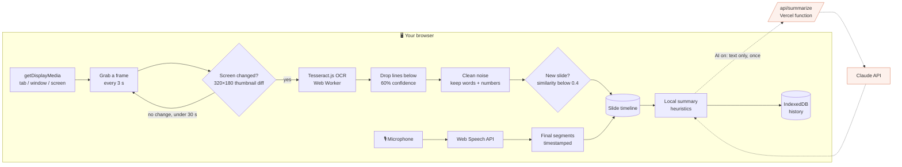
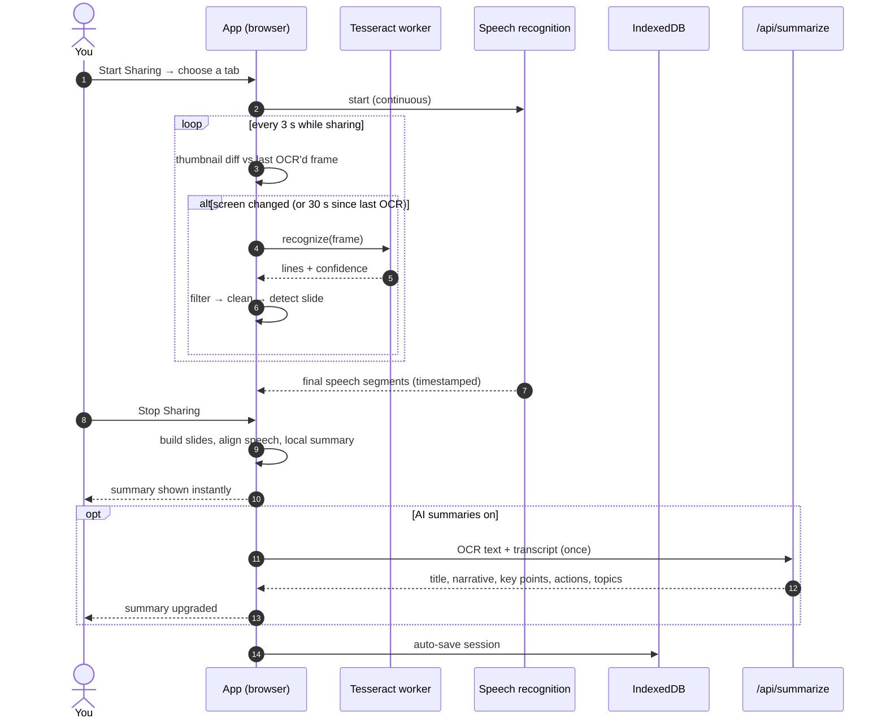

<div align="center">

# Screen Share Transcribe

**Turn any screen share — slides, demos, video calls — into a searchable transcript and summary, right in your browser.**

[](https://screenshare-transcribe.vercel.app)
[](https://github.com/arvinj1/screenshare-transcribe/actions/workflows/ci.yml)
[](https://vercel.com/new/clone?repository-url=https%3A%2F%2Fgithub.com%2Farvinj1%2Fscreenshare-transcribe&env=ANTHROPIC_API_KEY&envDescription=Optional%3A%20enables%20AI%20summaries%20via%20the%20Claude%20API)


**[▶ Open the app](https://screenshare-transcribe.vercel.app)** · [Quick start](#-quick-start) · [How it works](#-how-it-works) · [Privacy](#-privacy) · [Deploy](#-deploy-to-vercel) · [Whose Claude account?](#-whose-claude-account-is-used) · [Tuning](#-tuning-reference) · [FAQ](#-troubleshooting--faq)

</div>

---

## ✨ Features

| | |
|---|---|
| 🖥️ **Live slide OCR** | Reads the text on screen every few seconds with [Tesseract.js](https://github.com/naptha/tesseract.js), running locally in a Web Worker. |
| ⚡ **Change detection** | Compares tiny thumbnails first and only runs OCR when the screen actually changed — static slides cost almost nothing. |
| 🎙️ **Speech, aligned to slides** | Transcribes your microphone with the Web Speech API and attaches each sentence to the slide that was on screen. |
| 🧠 **Instant + AI summaries** | A local summary (title, key points, action items, topics) appears the moment you stop; with AI on, a Claude summary replaces it seconds later. |
| 🗂️ **Session history** | Every session auto-saves to your browser (IndexedDB). Search, rename, reopen, delete. |
| 📤 **Export** | Markdown, JSON, or copy to clipboard — with a per-slide timeline and the full transcript. |
| ⏱️ **Long-session safe** | Keeps every capture and segment for the whole session; the live panel stays fast by showing only recent slides. |
| 🎧 **Audio-only mode** | No screen? Just record and summarize a conversation. |

---

## 🚀 Quick start

### Use it

1. Open **[screenshare-transcribe.vercel.app](https://screenshare-transcribe.vercel.app)** in **Chrome or Edge** (best speech-recognition support). Nothing to install.
2. Pick a mode in the header: **Screen+OCR** or **Audio Only**.
3. Click **Start Sharing** (or **Start Recording** in Audio Only). The share picker opens on **Chrome Tab** — pick the tab with your slides or call.
   *Sharing a tab gives the cleanest text: there are no browser toolbars or menu bars for OCR to misread.*
4. Allow the microphone when asked, then present or talk as usual. Text and speech appear live, grouped by slide.
5. Click **Stop Sharing** (or the browser's own *Stop sharing* bar). Your summary appears, and the session saves to **History**.

<details>
<summary><b>💡 Tips for the best results</b></summary>

- **Share a tab, not a window.** Window and screen capture include the tab strip, address bar and bookmarks, which OCR reads as noise.
- **Bigger is better.** Present full screen or zoom in; small, low-contrast text is where OCR struggles.
- **Remote presenter?** Speech comes from your *microphone*, so play their audio through speakers (not headphones) for it to be transcribed.
- **Turn AI on** (header toggle) for a much more readable summary of noisy OCR and speech.

</details>

### Run it locally

```bash
git clone https://github.com/arvinj1/screenshare-transcribe.git
cd screenshare-transcribe
npm install
npm run dev          # http://localhost:5173
```

Requires **Node 18+**. AI summaries need the serverless function — see [Deploy](#-deploy-to-vercel) for running it locally with `vercel dev`.

---

## 🔍 How it works

### The capture pipeline

Everything to the left of the dashed line runs in your browser.



### A session, step by step



<details>
<summary><b>🔬 Stage-by-stage details</b> — click to expand</summary>

#### 1. Capture
[`useScreenCapture`](src/hooks/useScreenCapture.ts) calls `getDisplayMedia` with `displaySurface: 'browser'` (the picker opens on tabs) and `selfBrowserSurface: 'exclude'` (you can't accidentally share the app itself). Window and full-screen sharing are still available in the picker.

#### 2. Frame sampling and change detection
[`useFrameExtractor`](src/hooks/useFrameExtractor.ts) samples the video every 3 s. Before doing any expensive work it draws a **320×180 grayscale thumbnail** and compares it with the last frame that was sent to OCR ([`frameDiff`](src/services/frameDiff.ts)):

| Change on screen (1080p) | Pixels changed | Result |
|---|---|---|
| Mouse cursor moves | ~0.02% | skipped |
| One new word, 44 px text | ~0.08% | OCR |
| One new bullet, 24 px text | ~0.26% | OCR |
| New slide | ~1.5% | OCR |

Frames are also skipped while a previous OCR is still running, and OCR re-runs at least every 30 s as a safety net for very small edits. OCR'd frames are downscaled to at most 1920 px wide.

#### 3. OCR
[`ocrService`](src/services/ocrService.ts) runs Tesseract.js (English) in a Web Worker. It keeps only lines with **≥ 60% line confidence** — this removes most garbled UI text and misreads — and reports the frame's confidence as the average of the kept lines.

#### 4. Cleaning
[`textCleaner`](src/services/textCleaner.ts) drops tokens that look like OCR noise (no letters, repeated characters, `||||`-style misreads) while **keeping numbers** — slide numbers, years, percentages, prices, times and dates (`7:`, `2025`, `45%`, `$1,200`, `10:30`, `1/15/24`).

#### 5. Slide detection
[`useOCR`](src/hooks/useOCR.ts) compares each capture's words with the previous capture (Jaccard similarity). Below **0.4** it's a new slide. URLs, language and entities (emails, phones, dates, numbers, proper nouns) are extracted per capture.

#### 6. Speech
[`useAudioCapture`](src/hooks/useAudioCapture.ts) runs the Web Speech API continuously (`en-US`) and restarts it automatically when the browser ends a recognition run. Only *final* segments are kept.

#### 7. Alignment and summary
[`useSummary`](src/hooks/useSummary.ts) groups captures by slide, picks the longest capture as each slide's text, and attaches every speech segment whose timestamp falls inside that slide's time window (speech before the first capture goes to slide 1). [`textInference`](src/services/textInference.ts) then classifies the content (presentation, code, terminal, article, chat, spreadsheet, email, documentation) and extracts headings, key sentences, action items and topic clusters for the instant local summary.

#### 8. AI summary (optional)
With AI on, [`aiSummarizer`](src/services/aiSummarizer.ts) posts the deduplicated slide text and transcript to [`api/summarize.ts`](api/summarize.ts), a Vercel function that calls the Claude API and returns a title, narrative, key points, action items and topics. The local summary stays if the call fails or takes longer than 45 s.

#### 9. Storage and export
[`sessionStorage`](src/services/sessionStorage.ts) saves the full summary to IndexedDB once it settles. [`exportService`](src/services/exportService.ts) produces Markdown (stats, narrative, insights, per-slide timeline with *what was said*, URLs, transcript) and JSON.

</details>

---

## 🔒 Privacy

| Data | Where it goes |
|---|---|
| Screen video and frames | **Never leaves your browser.** OCR runs locally. |
| OCR text, summaries, history | Stored only in this browser's IndexedDB. |
| Microphone audio | Processed by the browser's speech recognition. **In Chrome and Edge this runs on the browser vendor's servers**, not on your device. |
| Captured *text* (AI on) | Sent **once per session** to `/api/summarize` → the Claude API, under the deployer's API key ([details](#-whose-claude-account-is-used)). Turn **AI off** in the header to keep text local. |

The Anthropic API key lives only in the server environment; it never reaches the browser.

---

## 🚢 Deploy to Vercel

The app is a static Vite build plus one serverless function, [`api/summarize.ts`](api/summarize.ts), which Vercel detects automatically — no `vercel.json` needed.

1. Click **Deploy with Vercel** above, or import the repo at [vercel.com/new](https://vercel.com/new).
2. Optionally add environment variables (below) to enable AI summaries.
3. Deploy. Without a key the API returns `503` and the app quietly uses local summaries.

| Variable | Required | Default | Purpose |
|---|---|---|---|
| `ANTHROPIC_API_KEY` | For AI summaries | — | Key from [console.anthropic.com](https://console.anthropic.com). |
| `SUMMARIZE_MODEL` | No | `claude-haiku-4-5-20251001` | Claude model used for summaries. |

<details>
<summary><b>Run the API locally</b></summary>

```bash
npm i -g vercel
echo "ANTHROPIC_API_KEY=sk-ant-..." > .env.local   # gitignored
vercel dev
```

`npm run dev` alone serves the app without the API; AI summaries then fall back to local ones.

</details>

### 🔑 Whose Claude account is used?

**The deployer's — never the end user's.** All Claude calls go through the server function, which signs them with the `ANTHROPIC_API_KEY` set in the Vercel project. So:

- **Users** need no Claude or Anthropic account, and never see or enter a key.
- **The owner of that API key** (the Anthropic Console organization it belongs to) is billed for every AI summary, by anyone using that deployment.
- It must be an **API key from [console.anthropic.com](https://console.anthropic.com)**, billed per token. A Claude.ai Pro/Max/Team subscription does not cover API usage.
- **If you fork and deploy your own copy**, your key is used and you pay; with no key set, your copy runs fully local summaries for free.

This applies to any future Claude feature as well, such as vision OCR on the [roadmap](#-roadmap): it would go through the same server function and the same key.

> [!NOTE]
> The public deployment at [screenshare-transcribe.vercel.app](https://screenshare-transcribe.vercel.app) currently has **no API key configured**, so it uses local summaries only; the **AI on** toggle quietly falls back to them.

> [!WARNING]
> `/api/summarize` has no authentication or rate limiting yet. Anyone who finds your deployment URL can use it to spend your Anthropic credit. Add rate limiting before sharing a public deployment widely.

---

## 🎯 Tuning reference

All the knobs, with where to change them:

| Setting | Value | File |
|---|---|---|
| Frame sampling interval | 3 s | [`App.tsx`](src/App.tsx) |
| Max OCR frame width | 1920 px | [`useFrameExtractor.ts`](src/hooks/useFrameExtractor.ts) |
| Change-detection thumbnail | 320×180 | [`frameDiff.ts`](src/services/frameDiff.ts) |
| Pixel brightness change that counts | > 24 / 255 | [`frameDiff.ts`](src/services/frameDiff.ts) |
| Changed pixels needed to re-OCR | > 0.05% | [`frameDiff.ts`](src/services/frameDiff.ts) |
| Forced re-OCR on unchanged screen | every 30 s | [`frameDiff.ts`](src/services/frameDiff.ts) |
| Min OCR line confidence | 60% | [`ocrService.ts`](src/services/ocrService.ts) |
| Min frame confidence to keep | 20% | [`useOCR.ts`](src/hooks/useOCR.ts) |
| New-slide similarity threshold | < 0.4 | [`useOCR.ts`](src/hooks/useOCR.ts) |
| Slides rendered in the live panel | 50 most recent | [`OCRResultList.tsx`](src/components/OCRResultList.tsx) |
| Long-session warning | 30 min | [`App.tsx`](src/App.tsx) |
| AI request timeout | 45 s | [`aiSummarizer.ts`](src/services/aiSummarizer.ts) |
| AI input cap | ~24,000 chars | [`api/summarize.ts`](api/summarize.ts) |

---

## 🌐 Browser support

| | Screen capture + OCR | Speech transcription |
|---|:---:|:---:|
| Chrome / Edge (desktop) | ✅ | ✅ |
| Safari | ✅ | ⚠️ limited |
| Firefox | ✅ | ❌ |
| Mobile browsers | ❌ (no screen capture) | — |

Without speech recognition the app still works — you just get slides without the transcript.

---

## 📁 Project structure

```text
api/
  summarize.ts            Vercel function → Claude API (the only server code)
src/
  App.tsx                 Session orchestration: modes, start/stop, auto-save
  hooks/
    useScreenCapture.ts   getDisplayMedia (tab-first picker)
    useFrameExtractor.ts  3 s sampling, change detection, downscaling
    useOCR.ts             OCR → cleaning → slide detection → entities
    useAudioCapture.ts    Web Speech API with auto-restart
    useSummary.ts         Slide building, speech alignment, local + AI summary
    useSessionHistory.ts  History state over IndexedDB
  services/
    frameDiff.ts          Thumbnail comparison
    ocrService.ts         Tesseract worker + line-confidence filter
    textCleaner.ts        Noise removal, similarity, keywords
    textInference.ts      Content type, key points, action items, topics
    entityExtractor.ts    Emails, phones, dates, numbers, proper nouns
    aiSummarizer.ts       Client for /api/summarize
    sessionStorage.ts     IndexedDB persistence and search
    exportService.ts      Markdown / JSON export
  components/             UI (header, live panel, summary, history, onboarding)
```

### Scripts

| Command | What it does |
|---|---|
| `npm run dev` | Vite dev server with hot reload |
| `npm run build` | Type-check (`tsc -b`) and production build to `dist/` |
| `npm run preview` | Serve the production build locally |

CI runs `npm ci && npm run build` on every push to `main` and every pull request.

---

## 🧰 Troubleshooting & FAQ

<details>
<summary><b>The summary has garbled text like browser tabs or bookmarks</b></summary>

You shared a window or the whole screen, so OCR also read Chrome's tab strip, address bar and bookmarks bar. Share the **Chrome Tab** instead (the picker opens there by default), or run your slides full screen.

</details>

<details>
<summary><b>The share picker shows a blank or black preview (macOS)</b></summary>

Give your browser screen-recording permission: **System Settings → Privacy & Security → Screen & System Audio Recording**, enable your browser, then restart it.

</details>

<details>
<summary><b>"No audio" appears in the header</b></summary>

Speech recognition isn't available (Firefox, some Safari versions) or microphone permission was denied. Use Chrome or Edge and allow the microphone. Screen OCR keeps working either way.

</details>

<details>
<summary><b>The speaker on my call isn't transcribed</b></summary>

Speech comes from the microphone, not the tab's audio. Play the call through speakers instead of headphones.

</details>

<details>
<summary><b>AI summaries never appear</b></summary>

- With `npm run dev`, the API isn't running — use `vercel dev`.
- On Vercel, check that `ANTHROPIC_API_KEY` is set (the function returns `503` without it).
- Make sure the header toggle says **AI on**.

</details>

<details>
<summary><b>Does a long session slow things down?</b></summary>

Static slides are skipped by change detection, and the live panel only renders the 50 most recent slides. The full session is still kept for the summary, export and history. After 30 minutes the app suggests splitting the session, because OCR on frequently changing content is CPU-heavy.

</details>

---

## 🧭 Roadmap

- [ ] Rate limiting / auth for `/api/summarize`
- [ ] Capture tab audio (not just the microphone)
- [ ] Optional Claude vision OCR for changed slides (charts, small text)
- [ ] Speech language selection (currently `en-US`)
- [ ] Unit tests for cleaning, slide alignment and export

## 🤝 Contributing

Pull requests are welcome. Please make sure `npm run build` passes and fill in the [pull request template](.github/pull_request_template.md).
