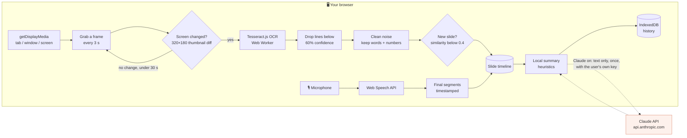
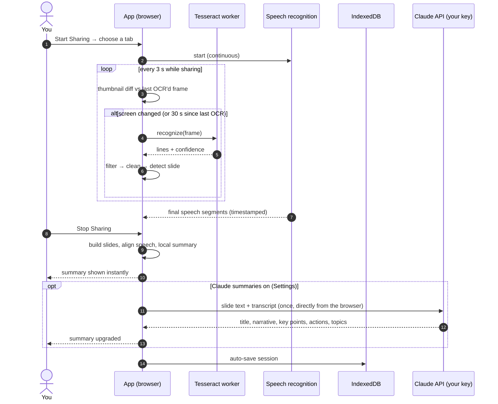

<div align="center">

# Screen Share Transcribe

**Turn any screen share — slides, demos, video calls — into a searchable transcript and summary, right in your browser.**

[](https://screenshare-transcribe.vercel.app)
[](https://github.com/arvinj1/screenshare-transcribe/actions/workflows/ci.yml)
[](https://vercel.com/new/clone?repository-url=https%3A%2F%2Fgithub.com%2Farvinj1%2Fscreenshare-transcribe)


**[▶ Open the app](https://screenshare-transcribe.vercel.app)** · [Quick start](#-quick-start) · [How it works](#-how-it-works) · [History](#-session-history) · [Privacy](#-privacy) · [Deploy](#-deploy-to-vercel) · [Whose Claude account?](#-whose-claude-account-is-used) · [Tuning](#-tuning-reference) · [FAQ](#-troubleshooting--faq)

</div>

---

## ✨ Features

| | |
|---|---|
| 🖥️ **Live slide OCR** | Reads the text on screen every few seconds with [Tesseract.js](https://github.com/naptha/tesseract.js), running locally in a Web Worker. |
| ⚡ **Change detection** | Compares tiny thumbnails first and only runs OCR when the screen actually changed — static slides cost almost nothing. |
| 🎙️ **Speech, aligned to slides** | Transcribes your microphone with the Web Speech API and attaches each sentence to the slide that was on screen. |
| 🧠 **Instant + Claude summaries** | An on-device summary (title, key points, action items, topics) appears the moment you stop. Add your own Anthropic API key in **Settings** and Claude rewrites it into a much clearer one. |
| 🗂️ **Session history** | Every session auto-saves in your browser, with no expiry. Search, rename, reopen, export, delete. [More](#-session-history) |
| 📤 **Export** | Markdown, JSON, or copy to clipboard — with a per-slide timeline and the full transcript. |
| ⏱️ **Long-session safe** | Keeps every capture and segment for the whole session; the live panel stays fast by showing only recent slides. |
| 🎧 **Audio-only mode** | No screen? Just record and summarize a conversation. |

---

## 🚀 Quick start

### Use it

1. Open **[screenshare-transcribe.vercel.app](https://screenshare-transcribe.vercel.app)** in **Chrome or Edge** (best speech-recognition support). Nothing to install.
2. Pick a mode in the header: **Screen+OCR** or **Audio Only**.
3. Click **Start Sharing** (or **Start Recording** in Audio Only). The share picker opens on **Chrome Tab** — pick the tab with your slides or call.
   *Sharing a tab gives the cleanest text: there are no browser toolbars or menu bars for OCR to misread.*
4. Allow the microphone when asked, then present or talk as usual. Text and speech appear live, grouped by slide.
   *Optional:* open **Settings** first and add your Anthropic API key for Claude-written summaries.
5. Click **Stop Sharing** (or the browser's own *Stop sharing* bar). Your summary appears, and the session saves to **History**.

<details>
<summary><b>💡 Tips for the best results</b></summary>

- **Share a tab, not a window.** Window and screen capture include the tab strip, address bar and bookmarks, which OCR reads as noise.
- **Bigger is better.** Present full screen or zoom in; small, low-contrast text is where OCR struggles.
- **Remote presenter?** Speech comes from your *microphone*, so play their audio through speakers (not headphones) for it to be transcribed.
- **Use Claude** (Settings → *Claude, with my API key*) for a much more readable summary of noisy OCR and speech.

</details>

### Run it locally

```bash
git clone https://github.com/arvinj1/screenshare-transcribe.git
cd screenshare-transcribe
npm install
npm run dev          # http://localhost:5173
```

Requires **Node 18+**. Everything, including Claude summaries, works with `npm run dev`: there's no server to run.

---

## 🔍 How it works

### The capture pipeline

Everything to the left of the dashed line runs in your browser.



### A session, step by step



<details>
<summary><b>🔬 Stage-by-stage details</b> — click to expand</summary>

#### 1. Capture
[`useScreenCapture`](src/hooks/useScreenCapture.ts) calls `getDisplayMedia` with `displaySurface: 'browser'` (the picker opens on tabs) and `selfBrowserSurface: 'exclude'` (you can't accidentally share the app itself). Window and full-screen sharing are still available in the picker.

#### 2. Frame sampling and change detection
[`useFrameExtractor`](src/hooks/useFrameExtractor.ts) samples the video every 3 s. Before doing any expensive work it draws a **320×180 grayscale thumbnail** and compares it with the last frame that was sent to OCR ([`frameDiff`](src/services/frameDiff.ts)):

| Change on screen (1080p) | Pixels changed | Result |
|---|---|---|
| Mouse cursor moves | ~0.02% | skipped |
| One new word, 44 px text | ~0.08% | OCR |
| One new bullet, 24 px text | ~0.26% | OCR |
| New slide | ~1.5% | OCR |

Frames are also skipped while a previous OCR is still running, and OCR re-runs at least every 30 s as a safety net for very small edits. OCR'd frames are downscaled to at most 1920 px wide.

#### 3. OCR
[`ocrService`](src/services/ocrService.ts) runs Tesseract.js (English) in a Web Worker. It keeps only lines with **≥ 60% line confidence** — this removes most garbled UI text and misreads — and reports the frame's confidence as the average of the kept lines.

#### 4. Cleaning
[`textCleaner`](src/services/textCleaner.ts) drops tokens that look like OCR noise (no letters, repeated characters, `||||`-style misreads) while **keeping numbers** — slide numbers, years, percentages, prices, times and dates (`7:`, `2025`, `45%`, `$1,200`, `10:30`, `1/15/24`).

#### 5. Slide detection
[`useOCR`](src/hooks/useOCR.ts) compares each capture's words with the previous capture (Jaccard similarity). Below **0.4** it's a new slide. URLs, language and entities (emails, phones, dates, numbers, proper nouns) are extracted per capture.

#### 6. Speech
[`useAudioCapture`](src/hooks/useAudioCapture.ts) runs the Web Speech API continuously (`en-US`) and restarts it automatically when the browser ends a recognition run. Only *final* segments are kept.

#### 7. Alignment and summary
[`useSummary`](src/hooks/useSummary.ts) groups captures by slide, picks the longest capture as each slide's text, and attaches every speech segment whose timestamp falls inside that slide's time window (speech before the first capture goes to slide 1). [`textInference`](src/services/textInference.ts) then classifies the content (presentation, code, terminal, article, chat, spreadsheet, email, documentation) and extracts headings, key sentences, action items and topic clusters for the instant local summary.

#### 8. Claude summary (optional)
With Claude chosen in **Settings**, [`aiSummarizer`](src/services/aiSummarizer.ts) sends the deduplicated slide text and transcript **from the browser straight to the Claude API**, using the user's own key and model choice (Opus 5.5, Sonnet 5.5 or Haiku 5.5). It asks for structured output (title, narrative, key points, action items, topics), and Opus and Sonnet can fall back to another model if a safety check declines. The Claude SDK is only downloaded when someone uses it. On any failure the on-device summary stays, and the summary shows why (for example, a rejected key or a spend limit).

#### 9. Storage and export
[`sessionStorage`](src/services/sessionStorage.ts) saves the full summary to IndexedDB once it settles. [`exportService`](src/services/exportService.ts) produces Markdown (stats, narrative, insights, per-slide timeline with *what was said*, URLs, transcript) and JSON.

</details>

---

## 📚 Session history

Every session is **saved automatically when you stop**: the summary, every slide, and the full transcript. Open **History** in the header to:

| Action | What it does |
|---|---|
| **Open** | Click a title to see that session's summary again. |
| **Search** | Looks through titles, slide text, transcripts, keywords, summaries and topics. |
| **Rename** | Give a session a clearer title. Claude summaries suggest one automatically. |
| **Export MD** | A readable Markdown file: summary, key points, action items, slide-by-slide timeline with *what was said*, URLs and transcript. |
| **Export JSON** | All the session data, for backups or other tools. |
| **Delete** | Removes the session from this browser permanently (asks to confirm). |

### Where it's kept, and for how long

- **Only in your browser, on this device** (IndexedDB). Nothing is uploaded or synced, and other people using the site can't see it. Another browser or computer has its own, separate history.
- **No expiry.** Sessions stay until you delete them or clear this site's data in your browser.
- **Exceptions:** private/incognito windows lose history when they close, and **Safari may remove a site's data after 7 days without a visit**. Chrome and Edge keep it unless the disk is nearly full.
- **Export anything you want to keep long-term.** There's no backup other than your exports.

Space isn't a concern: a 2-hour session takes well under 1 MB.

---

## 🔒 Privacy

| Data | Where it goes |
|---|---|
| Screen video and frames | **Never leaves your browser.** OCR runs locally. |
| OCR text, summaries, history | Stored only in this browser's IndexedDB, until you delete them ([details](#-session-history)). |
| Microphone audio | Processed by the browser's speech recognition. **In Chrome and Edge this runs on the browser vendor's servers**, not on your device. |
| Slide text and transcript (Claude on) | Sent **once per session, directly from your browser to Anthropic**, with your own API key ([details](#-whose-claude-account-is-used)). Never images, video or audio. Choose *On this device only* in Settings to keep everything local. |
| Your API key | Stored only in this browser: session storage by default (gone when the tab closes), or local storage if you tick *Remember on this device*. Sent only to `api.anthropic.com`. |

There is no app server: Vercel only serves static files, so nothing you capture passes through it.

---

## 🚢 Deploy to Vercel

The app is a fully static Vite build: no server code, no environment variables.

1. Click **Deploy with Vercel** above, or import the repo at [vercel.com/new](https://vercel.com/new).
2. Deploy. That's it. Pushes to `main` redeploy production automatically.

Any static host works too: run `npm run build` and serve `dist/`.

### 🔑 Whose Claude account is used?

**Each user's own.** Claude summaries are *bring your own key*:

- **Users who want Claude summaries** paste their own Anthropic API key in **Settings**. Their browser calls Anthropic directly, so **they are billed**, by Anthropic, for their own summaries.
- **Everyone else** gets the on-device summary, free, with no account needed.
- **You, the deployer, pay nothing** for anyone's summaries, and no key ever passes through your deployment.
- Keys come from [console.anthropic.com](https://console.anthropic.com/settings/keys) and are billed per token. A Claude.ai Pro/Max/Team subscription does not include API usage.

Rough cost of one typical session summary at list prices, shown in Settings next to each model:

| Model | Best for | Per summary |
|---|---|---|
| Claude Opus 5.5 (default) | Reading through noisy OCR and speech | ~7¢ |
| Claude Sonnet 5.5 | Balance of quality and speed | ~3¢ |
| Claude Haiku 5.5 | Speed and lowest cost | ~0.2¢ |

> [!TIP]
> Create a **dedicated key with a spend limit** for this app. A key you choose to remember is kept in this browser's local storage, where anyone with access to the browser profile (or a malicious extension) could read it.

---

## 🎯 Tuning reference

All the knobs, with where to change them:

| Setting | Value | File |
|---|---|---|
| Frame sampling interval | 3 s | [`App.tsx`](src/App.tsx) |
| Max OCR frame width | 1920 px | [`useFrameExtractor.ts`](src/hooks/useFrameExtractor.ts) |
| Change-detection thumbnail | 320×180 | [`frameDiff.ts`](src/services/frameDiff.ts) |
| Pixel brightness change that counts | > 24 / 255 | [`frameDiff.ts`](src/services/frameDiff.ts) |
| Changed pixels needed to re-OCR | > 0.05% | [`frameDiff.ts`](src/services/frameDiff.ts) |
| Forced re-OCR on unchanged screen | every 30 s | [`frameDiff.ts`](src/services/frameDiff.ts) |
| Min OCR line confidence | 60% | [`ocrService.ts`](src/services/ocrService.ts) |
| Min frame confidence to keep | 20% | [`useOCR.ts`](src/hooks/useOCR.ts) |
| New-slide similarity threshold | < 0.4 | [`useOCR.ts`](src/hooks/useOCR.ts) |
| Slides rendered in the live panel | 50 most recent | [`OCRResultList.tsx`](src/components/OCRResultList.tsx) |
| Long-session warning | 30 min | [`App.tsx`](src/App.tsx) |
| Claude request timeout | 120 s | [`aiSummarizer.ts`](src/services/aiSummarizer.ts) |
| Claude input cap | ~24,000 chars | [`aiSummarizer.ts`](src/services/aiSummarizer.ts) |
| Default Claude model | Opus 5.5 | [`aiSettings.ts`](src/services/aiSettings.ts) |

---

## 🌐 Browser support

| | Screen capture + OCR | Speech transcription |
|---|:---:|:---:|
| Chrome / Edge (desktop) | ✅ | ✅ |
| Safari | ✅ | ⚠️ limited |
| Firefox | ✅ | ❌ |
| Mobile browsers | ❌ (no screen capture) | — |

Without speech recognition the app still works — you just get slides without the transcript.

---

## 📁 Project structure

```text
src/
  App.tsx                 Session orchestration: modes, start/stop, auto-save
  hooks/
    useScreenCapture.ts   getDisplayMedia (tab-first picker)
    useFrameExtractor.ts  3 s sampling, change detection, downscaling
    useOCR.ts             OCR → cleaning → slide detection → entities
    useAudioCapture.ts    Web Speech API with auto-restart
    useSummary.ts         Slide building, speech alignment, local + AI summary
    useSessionHistory.ts  History state over IndexedDB
  services/
    frameDiff.ts          Thumbnail comparison
    ocrService.ts         Tesseract worker + line-confidence filter
    textCleaner.ts        Noise removal, similarity, keywords
    textInference.ts      Content type, key points, action items, topics
    entityExtractor.ts    Emails, phones, dates, numbers, proper nouns
    aiSettings.ts         Summary mode, user's API key (browser storage), model choice
    aiSummarizer.ts       Browser → Claude API with the user's key (loaded on demand)
    sessionStorage.ts     IndexedDB persistence and search
    exportService.ts      Markdown / JSON export
  components/             UI (header, on-page intro, settings, live panel, summary, history)
```

### Scripts

| Command | What it does |
|---|---|
| `npm run dev` | Vite dev server with hot reload |
| `npm run build` | Type-check (`tsc -b`) and production build to `dist/` |
| `npm run preview` | Serve the production build locally |

CI runs `npm ci && npm run build` on every push to `main` and every pull request.

---

## 🧰 Troubleshooting & FAQ

<details>
<summary><b>The summary has garbled text like browser tabs or bookmarks</b></summary>

You shared a window or the whole screen, so OCR also read Chrome's tab strip, address bar and bookmarks bar. Share the **Chrome Tab** instead (the picker opens there by default), or run your slides full screen.

</details>

<details>
<summary><b>The share picker shows a blank or black preview (macOS)</b></summary>

Give your browser screen-recording permission: **System Settings → Privacy & Security → Screen & System Audio Recording**, enable your browser, then restart it.

</details>

<details>
<summary><b>"No audio" appears in the header</b></summary>

Speech recognition isn't available (Firefox, some Safari versions) or microphone permission was denied. Use Chrome or Edge and allow the microphone. Screen OCR keeps working either way.

</details>

<details>
<summary><b>The speaker on my call isn't transcribed</b></summary>

Speech comes from the microphone, not the tab's audio. Play the call through speakers instead of headphones.

</details>

<details>
<summary><b>Claude summaries never appear</b></summary>

- Open **Settings**, choose *Claude, with my API key*, add your key and press **Test key**.
- If the summary says *Anthropic rejected this API key*, create a new key; if it mentions a rate or spend limit, check your [Anthropic Console](https://console.anthropic.com) limits and billing.
- An unticked *Remember on this device* means the key is gone after you close the tab; add it again or tick the box.

</details>

<details>
<summary><b>Is my API key safe?</b></summary>

It's sent only to `api.anthropic.com`, never to this site's server (there isn't one). Unless you tick *Remember on this device* it lives in session storage and disappears when the tab closes. A remembered key sits in local storage, readable by anyone who can use that browser profile, so use a dedicated key with a spend limit and press **Forget key** on shared computers.

</details>

<details>
<summary><b>Does a long session slow things down?</b></summary>

Static slides are skipped by change detection, and the live panel only renders the 50 most recent slides. The full session is still kept for the summary, export and history. After 30 minutes the app suggests splitting the session, because OCR on frequently changing content is CPU-heavy.

</details>

---

## 🧭 Roadmap

- [ ] Capture tab audio (not just the microphone)
- [ ] Optional Claude vision OCR for changed slides (charts, small text), with the same bring-your-own key
- [ ] Speech language selection (currently `en-US`)
- [ ] Unit tests for cleaning, slide alignment and export

## 🤝 Contributing

Pull requests are welcome. Please make sure `npm run build` passes and fill in the [pull request template](.github/pull_request_template.md).
